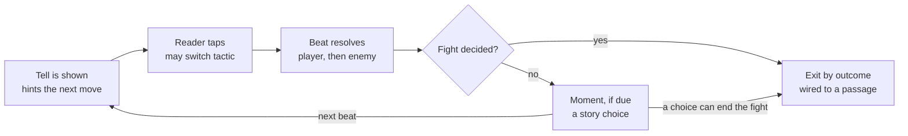

# Combat System Spec: Beats and Tells

Last updated: 25 November 2026

## Summary

Combat is a short, reader-paced sequence of beats inside a single encounter node. The enemy plays authored moves that are hinted at in captions, and the player's standing tactic resolves against each one automatically.

The guiding principle is that combat should create tension and narrative consequences, not become a separate game bolted onto the story.

This spec commits to seven decisions:

- **Reader-paced, not clocked.** The reader taps to advance each beat. Automatic means the player never picks attacks, not that a timer runs.
- **Three tactics.** Press, Steady and Guard. Steady is the autopilot.
- **Three enemy moves.** Strike, Heavy and Open, played from a short authored pattern.
- **Tells carry the decisions.** Each enemy's tells are clear, vague or hidden, and story knowledge can make them clear.
- **One number per item.** Weapons have a damage value. Armour is a per-fight buffer, not damage reduction.
- **No dice in resolution.** Outcomes are deterministic, so the editor can preview balance exactly.
- **Defeat is an exit, not an ending.** Every outcome is a named output on the node that the creator wires to a passage.

## Core loop

A fight is a run of beats, and each beat is one tap. If the reader never touches the tactic buttons, the fight still plays to an outcome on Steady.



A beat that decides the fight leaves by Victory or Defeat. Otherwise any moment that is due fires, and the next tell is shown.

Rules the picture does not show:

- **Standing tactic.** The chosen tactic stays in force until the reader changes it. Changing is free and applies to the beat about to resolve.
- **Order.** The player's hit lands first. An enemy reduced to zero health does not strike back.
- **Retreat.** A Retreat button sits beside the tactics unless the creator disables it. The enemy takes one free Strike (resolved as if on Steady), then the fight leaves by the Retreat exit — or by Defeat if that Strike reduces the player to 0 health.
- **Auto-advance.** A reader setting can advance beats after a reading delay. It is off by default and always stops at a moment.

## Stats and equipment

Combat uses three values per side, all small enough to count by hand.

| Value | Player | Enemy |
| --- | --- | --- |
| Health | 6. Carries between fights and is restored only by story effects | Set by the toughness preset |
| Damage | Set by the equipped weapon | Called Hit, set by the toughness preset |
| Armour | A buffer set by the equipped armour | None in version 1 |

Equipment has one number per item and three tiers. The names are examples; creators name their own.

| Tier | Example weapons | Damage | Example armour | Buffer |
| --- | --- | --- | --- | --- |
| 1 | Rusty Sword, Cheap Pistol | 2 | Padded Coat | 2 |
| 2 | Steel Sword, Service Pistol | 3 | Mail | 4 |
| 3 | Masterwork Sword, Plasma Pistol | 4 | Plate | 6 |

- **Armour is a buffer, not damage reduction.** It absorbs damage before health and refills after every fight. Subtracting armour from attack creates cliffs, where one tier turns a fight from deadly to harmless.
- **Health damage is lasting.** Anything that gets past the buffer stays until the story heals it, which separates scuffed from hurt.
- **No equipment management.** One weapon and one armour are equipped. Picking up a better one equips it and shows the change, for example "Steel Sword, damage 3 (was 2)".
- **Bare hands.** With no weapon, damage is 1. With no armour, the buffer is 0.

## Tactics and enemy moves

Three tactics meet three enemy moves, and each tactic is the best answer to exactly one move. In the table, D is the player's weapon damage and H is the enemy's Hit.

| Enemy move | Press | Steady | Guard |
| --- | --- | --- | --- |
| **Strike** | Deal D + 1, take H + 1 | Deal D, take H | Deal 0, take half of H, rounded up |
| **Heavy** | Deal D + 1, take 2H + 1 | Deal D, take 2H | Deal 0, take 0. The enemy's next move becomes Open |
| **Open** | Deal 2D, take 0 | Deal D, take 0 | Deal 0, take 0 |

- **Press** trades safety for speed. It is the answer to Open, and a gamble against Strike when the enemy is nearly down.
- **Steady** is the autopilot and the hedge. It is never the best answer to a move the reader can see coming, and never a disaster.
- **Guard** is the answer to Heavy. Against Strike it deals nothing, so guarding through Strikes roughly doubles the length of a fight.

Guarding a Heavy inserts one Open beat, then the enemy's pattern resumes. This produces the hammer-stuck-in-the-floor rhythm from the rules, without the creator scripting it.

## Enemy behaviour and tells

An enemy is a toughness preset plus a short authored loop of moves. There is no enemy AI.

| Toughness | Health | Hit | Default tells |
| --- | --- | --- | --- |
| Weak | 5 | 1 | Clear |
| Standard | 8 | 1 | Clear |
| Tough | 12 | 2 | Vague |
| Boss | 16, split across phases | 2 | Vague |

| Behaviour preset | Pattern, repeated | Feel |
| --- | --- | --- |
| Brawler | Strike, Strike, Heavy | Steady pressure with a big swing |
| Brute | Strike, Heavy | Slow and dangerous |
| Skirmisher | Strike, Strike, Strike, Open | Fast, then tires |

Creators can also write a custom pattern of any length from the three moves.

The caption at the end of each beat carries the tell for the next move. Tell clarity is what turns three buttons into a decision.

| Clarity | What the reader gets | Example |
| --- | --- | --- |
| Clear | A caption that plainly signals the move, plus a small intent icon by the enemy | "The creature pulls its enormous hammer above its head." |
| Vague | A caption that could mean two moves, with no icon | "The creature shifts its weight." |
| Hidden | No tell | None |

- **Captions come from pools.** Each move has one to three tell captions and one to three result captions. Genre-neutral defaults ship with the app, so a creator can write none.
- **No dice in resolution.** There are no to-hit rolls, misses or random criticals. Uncertainty comes from what the reader cannot see.
- **Optional variation.** A "shifty" enemy holds two patterns and picks one each time its loop restarts. The pick is seeded by playthrough and encounter, so reloading does not reroll it.

## Fight length and bosses

A normal fight lasts 3 to 6 beats, which is under a minute of reading. With tier 1 or 2 gear, a Standard enemy falls in 3 to 4 beats and a Tough one in 4 to 6.

The test for length is captions: if a creator cannot write that many distinct beats for an enemy, the fight is too long.

Bosses use the same rules and feel different through structure, not new stats:

- **Phases.** A boss has two or three phases. Each phase has its own pattern and illustration, and starts when health crosses a threshold.
- **A moment between phases.** Each phase change pauses the fight for a story choice.
- **One rule-break.** A boss may break exactly one rule from a short list: a Heavy that cannot be blocked without a named item, tells that stay hidden until a flag is set, or health that cannot drop below a threshold until a moment resolves.
- **Other ways to win.** A fight can end on "survive N beats" or on reaching a moment, instead of on zero health.

A boss should run 8 to 12 beats in total. The Boss numbers are a starting point and have not been simulated.

## Story integration

Story state reaches combat through two lists on the encounter: modifiers, which change the fight when it starts, and moments, which pause it for a choice.

A modifier is a condition plus one effect from a fixed menu. Conditions use the same format as story choices: a flag is set, an item is held, or a stat passes a comparison.

| Effect | What it does | Story example |
| --- | --- | --- |
| Change enemy health | Adds or removes health before beat 1 | The player sabotaged the robot, so it starts damaged |
| Change enemy Hit | Raises or lowers Hit | The guard was poisoned at dinner |
| Reveal tells | Sets all tells to clear | The player found the monster's weakness |
| Ally acts | On a set beat, deals damage and shows a caption | A rescued companion intervenes |
| Swap pattern | Replaces the enemy's pattern | An equipped charm makes the wraith hesitate |
| Bonus buffer | Adds armour buffer for this fight | The player took the high ground |
| Unlock choice | Adds a choice to a moment | A story flag opens a way to talk |
| Unlock exit | Enables a custom outcome | The enemy can be recruited |

Reveal tells is the effect that matters most. It makes story knowledge the thing that lets the reader read the fight.

A moment fires once when its trigger is met: enemy health at or below a value, player health at or below a value, a beat number, or a phase start. It shows a caption and two or three choices, for example "The knight falls to one knee" with Finish him, Demand surrender and Retreat. Each choice either continues the fight with an optional effect or leaves by a named exit.

## Outcomes and defeat

Every way a fight can end is a named exit on the encounter node, and the creator wires each exit to a passage.

| Exit | Fires when | Always present |
| --- | --- | --- |
| Victory | Enemy health reaches 0, or another win condition is met | Yes |
| Defeat | Player health reaches 0 | Yes |
| Retreat | The reader presses Retreat | Unless disabled |
| Custom, such as Surrender or Captured | A moment choice names it | No |

- **Exit effects.** Each exit can set flags, add or remove items, change health and add a wound. Losing a fight can cost the sword, not the story.
- **Defeat continues the story.** Leaving by Defeat sets health to 1 unless the exit's effects say otherwise. Game Over is an ending passage the creator chooses to wire, not a default.
- **Manner flags.** The encounter records how it ended: clean if no health was lost, bloodied if the player finished at 2 health or less. Later passages can test these like any other flag.
- **Wounds.** A wound is a named story object, such as "Cracked rib", that lowers maximum health by 1 until a story effect removes it. It appears in the inventory with its own text.
- **Validation.** The builder reports an error when Victory is not wired and a warning when Defeat or Retreat is not wired.

## Presentation

The combat screen is a comic panel with three buttons under it, designed for a phone held in one hand. From top to bottom:

1. **Illustration.** The encounter art fills the top of the screen.
2. **Health.** Two rows of pips sit on the art, one per side. The player's armour buffer shows as outlined pips ahead of the health pips.
3. **Caption box.** One short caption per beat, in the same style as story passages.
4. **Tell.** The tell for the next move appears as a second caption in a distinct style. A clear tell also shows an intent icon by the enemy.
5. **Tactic bar.** Press, Steady and Guard sit at thumb height with the current one highlighted. Retreat is a smaller button beside them.

Rules for keeping it a graphic novel:

- **No floating numbers.** Hits show as a panel shake, a lost pip and lettered sound effects.
- **Tap anywhere to advance.** The tactic bar is the only other control.
- **Moments look like story.** A moment replaces the tactic bar with ordinary story choices.
- **Art variants are optional.** One image is required. A creator may add variants for enemy Open, enemy wounded, player wounded and each boss phase.
- **The fight becomes a page.** When the fight ends, its panels and captions collapse into a strip the reader can scroll back through.

## Creator configuration

A working fight needs three fields: an enemy name and image, a toughness preset and a behaviour preset. Everything else is optional.

| Field | Required | Default |
| --- | --- | --- |
| Enemy name and image | Yes | None |
| Toughness | Yes | Standard |
| Behaviour | Yes | Brawler |
| Custom pattern | No | From the behaviour preset |
| Tell clarity | No | From the toughness preset |
| Captions | No | Built-in pools |
| Modifiers | No | None |
| Moments | No | None |
| Custom exits | No | Victory, Defeat and Retreat only |
| Allow retreat | No | On |
| Art variants | No | None |

Because resolution has no dice, the editor can play every fight in advance and show the creator the result. This balance preview runs two readers through the encounter, for each gear tier the story can supply by that point:

- **Autopilot** stays on Steady for the whole fight.
- **Careful** plays Steady against Strike, Guard against Heavy and Press against Open.

A simulation of this spec's numbers gives the preview below. The target is that autopilot wins a Standard fight at a cost, and a Tough fight demands either attention or better gear.

| Enemy | Gear tier | Autopilot | Careful |
| --- | --- | --- | --- |
| Weak Skirmisher | 1 | Wins in 3 beats, no health lost | Wins in 3 beats, no health lost |
| Standard Brawler | 1 | Wins in 4 beats, loses 2 health | Wins in 4 beats, no health lost |
| Tough Brute | 1 | Defeated on beat 3 | Wins in 6 beats, loses 2 health |
| Tough Brute | 2 | Wins in 4 beats, loses 4 health | Wins in 4 beats, no health lost |

## Data model

An encounter is one node on the story map with one output per exit. Its configuration is a single JSON object, and individual attacks never become nodes.

```json
{
  "type": "encounter",
  "enemy": {
    "name": "Hammer Brute",
    "image": "brute.png",
    "toughness": "tough",
    "health": 12,
    "hit": 2
  },
  "behaviour": "brute",
  "pattern": ["strike", "heavy"],
  "altPattern": null,
  "tellClarity": "vague",
  "captions": {
    "tell": { "heavy": ["The creature shifts its weight."] },
    "result": { "heavyBlocked": ["The hammer crashes into the floor and sticks there."] }
  },
  "art": { "open": "brute-stuck.png" },
  "modifiers": [
    { "if": { "flag": "sabotaged_robot" }, "effect": "enemyHealth", "value": -3 },
    { "if": { "flag": "knows_weakness" }, "effect": "revealTells" },
    { "if": { "flag": "rescued_mira" }, "effect": "allyActs", "beat": 3, "damage": 2,
      "caption": "Mira drives her knife into its flank." }
  ],
  "moments": [
    {
      "trigger": { "enemyHealthAtMost": 3 },
      "caption": "The brute falls to one knee.",
      "choices": [
        { "label": "Finish it.", "then": "continue" },
        { "label": "Demand surrender.", "then": "exit", "exit": "surrender" }
      ]
    }
  ],
  "phases": [],
  "winCondition": { "type": "enemyHealthZero" },
  "allowRetreat": true,
  "exits": {
    "victory": { "effects": [] },
    "defeat": { "effects": [{ "removeItem": "steel_sword" }, { "addWound": "Cracked rib" }] },
    "retreat": { "effects": [] },
    "surrender": { "label": "Surrender", "effects": [{ "setFlag": "brute_spared" }] }
  }
}
```

- **Exits as edges.** Each exit key becomes an output handle on the node. Storing exit targets the same way choice targets are stored keeps edge sync and delete behaviour unchanged.
- **Preset values are copied in.** Choosing a toughness or behaviour writes health, hit and pattern into the encounter, so a later change to a preset does not rebalance finished stories.
- **Player state gains five fields.** Health, maximum health, equipped weapon with its damage, equipped armour with its buffer, and a list of wounds.
- **Runtime state is small.** A fight in progress holds enemy health, player buffer, beat number, pattern index, phase, current tactic, a pending Open flag and the list of fired moments. Saving these lets a reader leave mid-fight and resume.
- **The resolver is a pure function.** It takes runtime state, the encounter and a tactic, and returns the next state plus the captions to show. The player and the balance preview both call it.

## Out of scope

These mechanics are excluded on purpose. Each one either adds a second game to learn or produces beats that are not worth a caption.

| Excluded | Why | What covers the need |
| --- | --- | --- |
| To-hit rolls, misses, random criticals | "You miss" is a wasted beat, and random deaths feel cheap in a story | Hidden and vague tells |
| A real-time clock | Punishes slow readers and pulls the eye from the art | Reader-paced beats with optional auto-advance |
| Choosing individual attacks | Turns a scene into a menu | A standing tactic |
| Status effects | Needs icons, timers and rules text | Modifiers and wounds |
| Damage types and resistances | Multiplies balancing work | Modifiers tied to flags and items |
| Cooldowns, mana, action points | A resource game beside the story | Nothing |
| Experience and levels | Progress should come from the story | Equipment tiers and flags |
| Using items from a menu mid-fight | Inventory micromanagement | Moment choices unlocked by items |
| Several enemies at once | Targeting and turn order | One enemy that represents the group, such as "the pack" |
| Controlling companions | Party management | The Ally acts modifier |
| Enemy armour | A fourth number to tune | Enemy health |

## Open questions and build order

Six decisions are still open:

- [x] **Confirmed (Issue #2):** Armour stays a per-fight buffer (tiers 2, 4, and 6 pips) that absorbs damage before health and refills after every fight.
- [x] **Confirmed (Issue #11):** No beat cap for now. Simulations across all nine Weak/Standard/Tough preset combinations at tier 1 show careful play wins faster everywhere (3–6 beats vs 6–12) and loses equal or less health in 8 of 9 matchups (Tough Brute is the sole 1 HP trade-off at 9 beats vs 6).
- [ ] Health only returns through story effects. Decide whether the app should offer a standard "rest" effect so creators do not starve readers by accident.
- [x] **Confirmed (Issue #3):** Retreat costs one free enemy Strike (resolved as if on Steady); if that Strike takes the player to 0 health, the fight leaves by Defeat. Per-encounter pricing is deferred until creators ask for it.
- [x] **Confirmed (Issue #17):** Ship exact pips for enemy health so readers can judge when Press is worth the risk. Revisit a described state as a future boss rule-break rather than a global setting.
- [ ] Boss numbers and the three rule-breaks need a simulation pass before they are offered to creators.

Suggested build order, each step usable on its own:

1. **Resolver.** The pure function and its tests, using the resolution table.
2. **Balance preview.** Autopilot and careful readers run through the resolver.
3. **Encounter node.** The node in the builder with presets, exits as output handles and validation.
4. **Combat screen.** The mobile player view with captions, pips and the tactic bar.
5. **Modifiers and moments.** The condition and effect lists, and threshold choices.
6. **Bosses and polish.** Phases, art variants and the end-of-fight page.

The implementation plan and ticket index are in [combat-system-plan.md](combat-system-plan.md).
